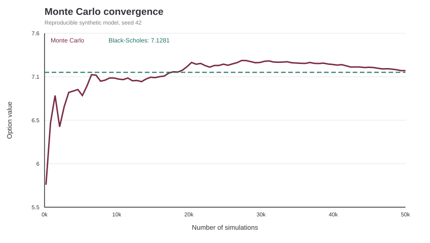
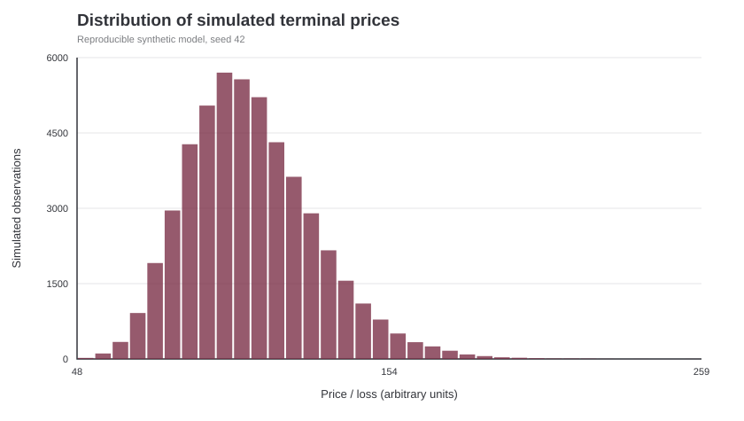
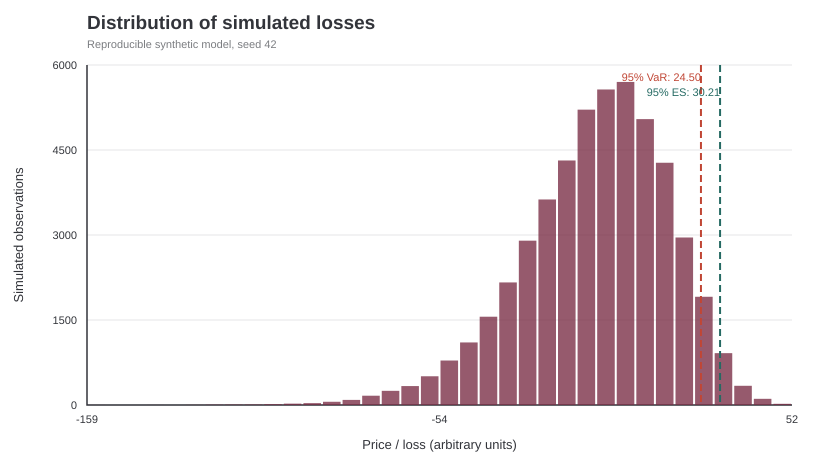
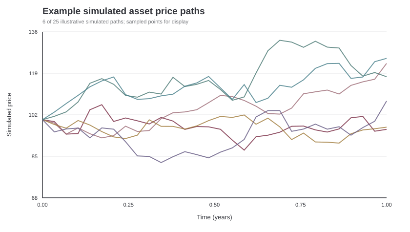

# Monte Carlo option pricing and financial risk

**Python | NumPy | SciPy | Matplotlib | Numerical experiment with synthetic data**

This project explores the Monte Carlo method in a simple financial setting. I use random sampling to estimate the price of a European call option, compare it with the Black-Scholes formula, and calculate a few model-based risk measures.

The purpose is to understand the numerical method and its limitations, **not** to predict real financial markets.

## Questions

- How closely does a Monte Carlo estimate match the analytical option price?
- What happens when the sample size grows?
- Can antithetic sampling decrease the standard error?
- Can Delta be estimated using a finite difference?
- What do Value at Risk and Expected Shortfall describe under the assumed model?

## Model

The terminal price is sampled using a lognormal model:

$$
S_T=S_0\exp\left[\left(a-\frac{\sigma^2}{2}\right)T+\sigma\sqrt{T}Z\right], \qquad Z\sim N(0,1).
$$

For **option pricing**, I set \(a=r\) and average discounted call payoffs. In the **separate investment-risk experiment**, I set \(a=\mu\) and analyse the loss \(L=S_0-S_T\). These are different modelling assumptions.

I use a given terminal-price formula, without deriving the underlying stochastic process. More details are in [mathematical notes](notes/MATH_NOTES.md).

## Running the project

Python 3.10+:

```bash
python -m pip install -r requirements.txt
python monte_carlo.py
python checks.py
python plots.py
```

The `plots.py` script creates four PNG figures inside `results/` on your computer.

## Example output

Parameters: initial price 100, strike 105, interest rate 3%, assumed physical return 7%, volatility 20%, one-year horizon, **50,000** samples, fixed random seed 42. Values are arbitrary currency units (CU).

| Quantity | Result |
|---|---:|
| Black-Scholes call | 7.1281 |
| Ordinary Monte Carlo call | 7.1485 |
| Estimated standard error | 0.0564 |
| Approximate 95% CI | [7.0380, 7.2589] |
| Antithetic price | 7.1453 |
| Antithetic standard error | 0.0466 |
| Analytical Delta | 0.5024 |
| Finite-difference Delta | 0.5009 |
| 95% VaR | 24.5020 |
| 95% Expected Shortfall | 30.2133 |

These numbers correspond to the reproducible base experiment; generated figures show convergence, final prices, loss distribution and sample paths.

## Visual results

The figures below use the same model parameters and seeded numerical samples as the current Python implementation. The repository also includes `plots.py`, which can generate PNG versions locally.

**1. Convergence of the Monte Carlo estimate**



**2. Simulated terminal prices**



**3. Simulated losses, Value at Risk and Expected Shortfall**



**4. Selected simulated price paths**



The fourth SVG displays six selected paths for legibility; `plots.py` can generate a PNG displaying all 25 paths.

## Conclusions

The Monte Carlo estimate was close to the analytical Black-Scholes price: the difference was about **0.0204 CU**, smaller than the estimated standard error. The analytical value also fell within the approximate confidence interval.

With more samples, the running estimate generally stabilises, but adding observations does not guarantee that every intermediate result gets closer to the analytical price.

Pairing opposite random draws reduced the estimated standard error from **0.0564** to **0.0466** in this run. It does **not** guarantee that every single estimate is closer to the true value. The numerical Delta (0.5009) was also close to the analytical one (0.5024).

The VaR and Expected Shortfall values depend on a hypothetical lognormal price model and its chosen parameters. They are **not forecasts** of real market losses.

## Limitations and possible extensions

There is no historical calibration; volatility is constant and the model cannot describe all real-world extreme events. The confidence interval measures Monte Carlo sampling uncertainty *under the model*, not uncertainty about whether the model itself is appropriate.

Possible next steps include comparing seeds, varying volatility and strike price, and exploring historical data.

## Files

- [monte_carlo.py](monte_carlo.py) – main numerical calculations
- [plots.py](plots.py) – produce four figures
- [checks.py](checks.py) – elementary numerical checks
- [MATH_NOTES.md](notes/MATH_NOTES.md) – assumptions and definitions

## Project development and my contribution

I initiated this project to explore how Python and numerical methods can be applied to a problem in quantitative finance. I helped shape the objectives and requirements, including a focus on NumPy, a mathematical explanation that matches my physics background, readable code, reproducible examples and clear visualisations. I also gave feedback on the scope, coding style and presentation as the project developed.

AI assistance was used to prepare the first version of the code and documentation and to check numerical calculations. The implementation and assumptions are available here for review and further development.
